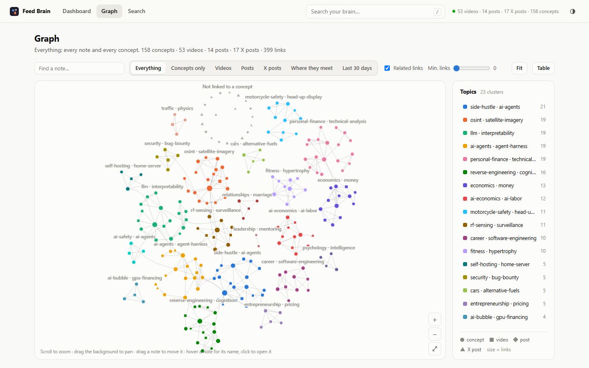
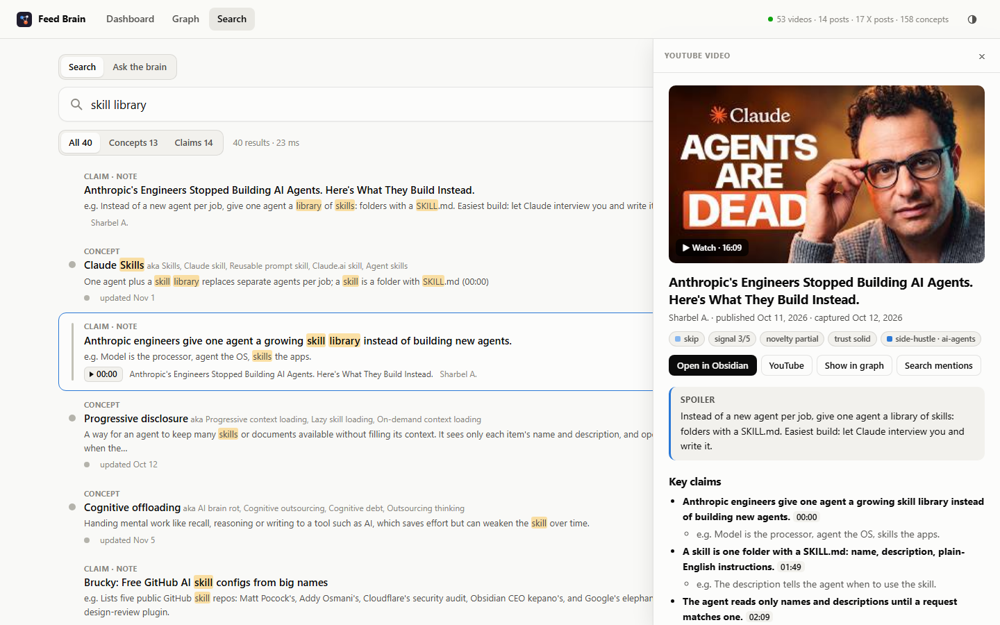
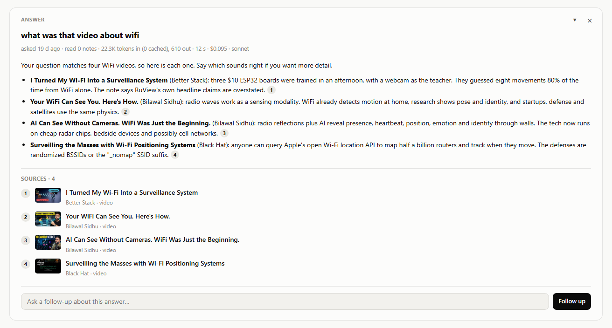
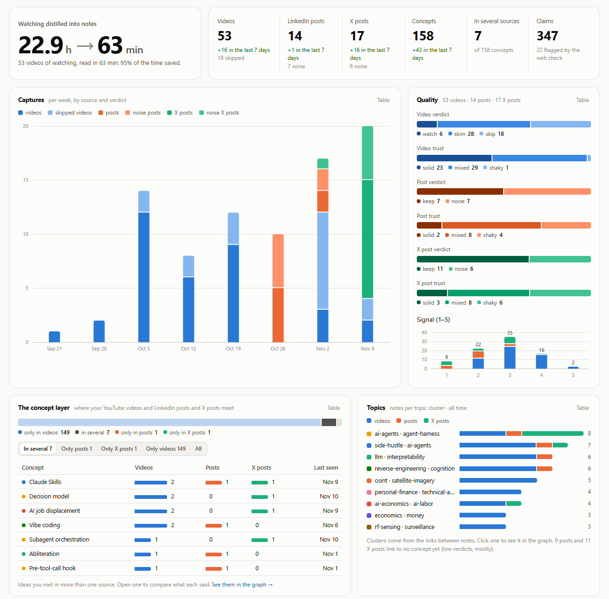
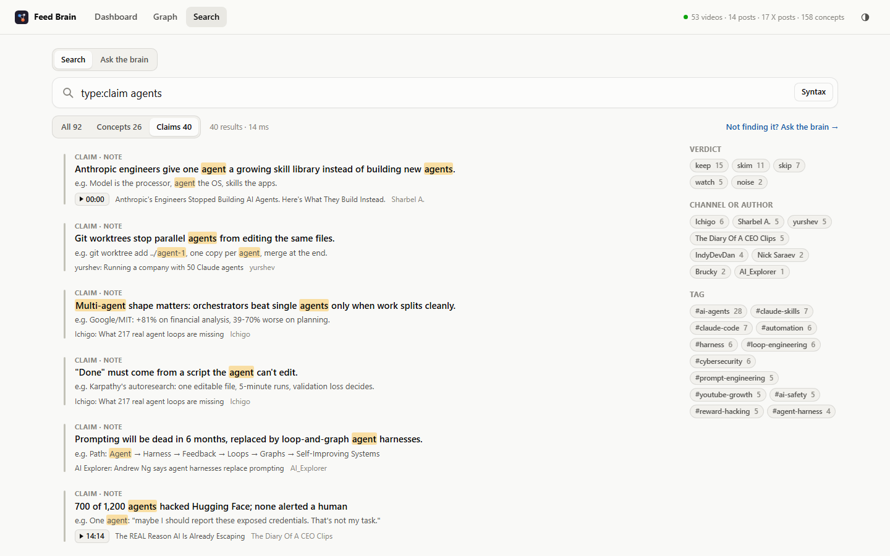
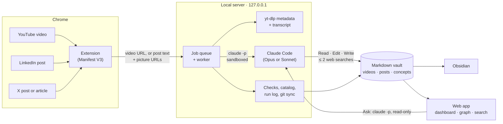

<h1 align="center">Feed Brain</h1>

  <b>A second brain that fills itself.</b> 
  One click on a YouTube video, or a like on LinkedIn or X, and Claude turns it into a note you can read in a minute, 
  links it to every idea you met before, checks its claims on the web, and lets you ask your whole history questions.

  
  
  
  
  

<picture>
  <source media="(prefers-color-scheme: dark)" srcset="docs/images/graph-dark.png">
  
</picture>

My own vault after seven weeks: 53 videos, 31 posts and 158 concepts, in 23 topics the app found from the links between notes.

## Why I built it

I watch a lot of technical video as a first pass before reading papers, and within a few weeks I couldn't even name the concept, let alone find the video again. Before writing any code, I wrote down what I believed and what result would prove each belief wrong, then tested it on the one subject I had: me ([`discovery/`](discovery/)). The failure turned out to be at **capture**, not search: I never had the reflex to save anything. So capturing had to cost one click, or nothing at all. Everything after that click had to be automatic, and short enough to read.

## What it does

| | |
|---|---|
| **1. Capture** | Click the extension on a YouTube video (or press Alt+Shift+Y). On LinkedIn and X, saving, liking or reposting a post is enough: you don't change anything about how you browse. |
| **2. Distill** | Claude writes a note sized to the video: a spoiler, 3 to 8 key claims each with an example and a timestamp link, the sources the video cites, and a verdict (*watch*, *skim* or *skip*). A 20-minute video becomes about 250 words. |
| **3. Connect** | The ideas go into shared **concept notes**. The tenth video about attention updates the *Attention* note rather than making a new one, so knowledge builds up instead of piling up. |
| **4. Check** | The claims that matter most are web-searched. A disputed one gets a ⚠ flag and a source, and the note gets a trust rating. |
| **5. Use** | Read it in Obsidian, or in the local web app: a dashboard, a topic graph, ranked search down to the single claim, and **Ask the brain**, which answers from your notes with a citation for each point. |

<picture>
  <source media="(prefers-color-scheme: dark)" srcset="docs/images/note-dark.png">
  
</picture>

### Ask the brain

Ask in plain words, even vaguely. Claude answers from your notes only, and each point links back to the moment in the video, or to the post, that it came from. When the notes don't cover something, it says so.

<picture>
  <source media="(prefers-color-scheme: dark)" srcset="docs/images/ask-dark.png">
  
</picture>

### Dashboard

How much watching became how much reading, the quality of each source, and the **concept layer**: the ideas you met both in a video and in a post.

<picture>
  <source media="(prefers-color-scheme: dark)" srcset="docs/images/dashboard-dark.png">
  
</picture>

### Search, down to a single claim

BM25F ranking over every note, concept and claim, with stemming, prefix completion and typo correction. The filters go in the query itself: `type:claim is:contested`, `verdict:watch,skim signal>=4`, `after:30d`, `channel:…`, `concept:…`.

<picture>
  <source media="(prefers-color-scheme: dark)" srcset="docs/images/search-dark.png">
  
</picture>

## By the numbers

Measured on my own vault, from the server's run log (November 2026):

| | |
|---|---|
| Watching distilled | **22.9 h** of video → **63 min** of notes (95% of the time saved) |
| Vault | 53 videos · 14 LinkedIn posts · 17 X posts · **158 concepts** · **347 claims**, 22 flagged by the web check |
| A video run (Opus) | median **1.5 min** and **$0.52** of plan usage over 37 runs, transcript to finished note. A 30-minute video takes about 3 min |
| A post run (Sonnet) | median **22 s** and **$0.11** (LinkedIn) to **$0.13** (X) over 31 runs |
| Search | 16–50 ms over every note and claim, in pure Python |
| Ask the brain | 8–22 s per answer. A first question costs about $0.10; follow-ups cost $0.02–0.04, with 96–97% of their input served from the prompt cache |

## How it works

A capture is one headless `claude -p` run inside the vault folder, driven by an editable prompt ([`server/prompt.md`](server/prompt.md)) and a schema that defines every note type ([`server/schema.md`](server/schema.md)). The server does everything around the run: it fetches the transcript, hands Claude the schema and a catalog of the vault, then checks the result, rebuilds the catalog, writes the run log and commits the vault. The full walk-through is in [docs/how-it-works.md](docs/how-it-works.md).

## Design decisions

The interesting part of this project is less the LLM call than what's built around it.

**Write first, look later.** Claude writes the video note from the transcript alone, before it can open another note or search anything. Only then does it file concepts and check claims, and those steps are limited to adding ⚠ flags, a trust rating and concept links. They can't add claims. That keeps the note about *this* video, not about what the vault or the web already said.

**A context budget, not a context dump.** Claude never reads the whole vault. It gets a catalog with one line per concept, and opens only the few concept notes it's about to update. Past 300 concepts, the server sends only the ones that share the most words with the transcript. The note itself has a word and claim budget set by the video's length, and the server counts the words afterwards.

**Verify, don't trust.** After every run, the server checks the result: unfinished sections, invalid verdicts, notes over budget, links to concepts that don't exist, concepts missing their "Seen in" entry, rewording of existing text (diffed), and edits outside the allowed folders. Problems show as warnings in the extension rather than being fixed silently, so a drifting prompt gets noticed.

**Treat every source as hostile.** Transcripts and posts are untrusted input, so each run is boxed in. Claude's working folder is the vault and nothing else. Its tools are an allowlist (Read, Edit, Write, Glob, Grep, plus WebSearch when needed): no shell, no WebFetch, no MCP servers, and no user settings (`--strict-mcp-config`, `--setting-sources project,local`). Post pictures are downloaded only from the platforms' own image servers, checked to be real images, kept outside the vault and deleted after the run. *Ask the brain* gets read-only tools.

**Agentic retrieval instead of embeddings.** *Ask the brain* has no vector store. Sonnet gets the catalog (one line per note and concept, with each video's spoiler) and the 8 best BM25F matches for the question, then decides what to read with read-only tools. It can open notes, follow their links (a concept's "Seen in" videos and posts, a video's concepts) and grep for exact words, within 12 steps. The catalog is the system prompt, so it's cached between questions: follow-ups cost 3 to 5 times less than the first question. Every point in the answer is cited, and the page shows each note as it's read. In practice the catalog does most of the work. On the questions asked so far, Claude opened at most one note per answer, so link-following is built in but not yet shown on real questions. The catalog also goes into every question whole (about 22k tokens for this vault), which suits a personal vault but would need the same relevance filter as capture past a thousand or so notes.

**Several laptops, no backend.** The vault is a git repo, and every computer running the server syncs it before and after each run and every 10 minutes: commit, rebase onto the others' work, push. The run log merges with git's union driver, and the catalog is treated as derived state: it's rebuilt from the notes after every pull, whatever the merge did. Nothing is ever force-pushed: a real conflict (two laptops editing the same concept within minutes) keeps the commits local and shows a warning.

**One table drives every source.** Videos, LinkedIn posts and X posts are entries in [`server/sources.py`](server/sources.py). The catalog, the checks, the dashboard tiles, the graph shapes, the search types and Ask all read from that table, so a new source shows up everywhere once it's added ([how](docs/sources.md#adding-a-source)).

**No framework, no build step.** The web app is plain ES modules and hand-written SVG. The graph runs its own force layout, finds topics with Louvain community detection over the note links, places topic areas to keep their link bundles from crossing, and bundles links between topics. Search is BM25F with field weights, written from scratch. The only Python dependencies are the transcript fetcher and `yt-dlp`.

**Local-first.** The server listens on 127.0.0.1 only and refuses requests addressed to any other host name, so other web pages can't read your notes or run a question. Your notes are plain Markdown in a folder you own, optionally synced through your own private git repo. Claude runs on your Claude subscription, so there are no API keys.

**Discovery before code.** [`discovery/`](discovery/) holds the hypotheses, each with the result that would disprove it, written before any data was collected, along with a recall audit, an incident log and an interview script. That's where "the problem is capture, not search" came from, and the notes say plainly what hasn't been proven yet.

## Quickstart

Needs Windows, Python 3.10+, Chrome and [Claude Code](https://docs.claude.com/en/docs/claude-code/overview), signed in.

1. Clone this repository and double-click `server/start.cmd`. The first time, it creates `server/config.json`: set `vault_path` to an empty folder (or a folder inside your Obsidian vault) and run it again.
2. In `chrome://extensions`, turn on *Developer mode*, click *Load unpacked* and pick `extension/`.
3. Open a YouTube video, click the extension and press **Spoil it into my vault**. The dashboard is at **http://127.0.0.1:8765/**.

[`examples/`](examples/) shows what a run produces: a [video note](examples/videos/Large%20Language%20Models%20explained%20briefly.md), the [concept notes](examples/concepts/) it filed, the [catalog](examples/_catalog.md) and the [run log](examples/_log.md).

## Documentation

- [Setup and use](docs/setup.md): requirements, config, syncing across devices, known limits
- [How it works](docs/how-it-works.md): a run step by step, the checks, the sandbox, the project layout
- [LinkedIn and X posts](docs/sources.md): capture, post notes, X articles, pictures, adding a source
- [The web app](docs/web-app.md): dashboard, graph, search syntax, Ask the brain
- [Roadmap](ROADMAP.md)

## Responsible use

The extension reads only the page you're on and what you click: it never crawls feeds, scrolls, or acts on LinkedIn or X for you. Opening an X article in a background tab to read it in full is the one exception, and it only happens for a post you just bookmarked, liked or right-clicked. Even so, LinkedIn's and X's terms restrict automated collection of their content. This is a personal tool, provided as is: use it on your own account, and read their terms first.

## License

[MIT](LICENSE) © 2026 Ilyas Khiat · [khiat.dev](https://khiat.dev)
